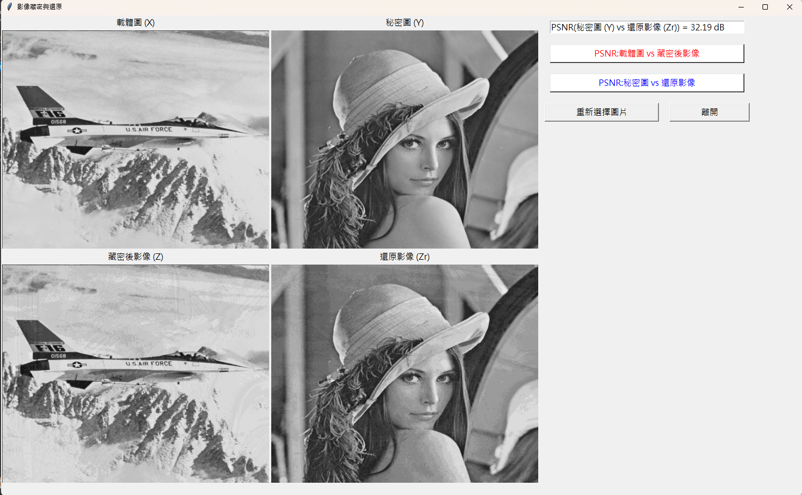

# 影像藏密與還原 (Image Hiding & Recovery)

Multimedia Security 期末專題。選擇兩張相同尺寸的灰階圖片,把「秘密圖」藏進「載體圖」,並可還原出秘密圖,同時以 PSNR 評估失真程度。



## 功能

- 選擇載體圖 (X) 與秘密圖 (Y),兩張圖尺寸必須相同
- 產生藏密後影像 (Z) 與還原影像 (Zr),四張圖同時顯示,視窗縮放時自動調整大小
- 一鍵計算並顯示 PSNR(單位 dB):
  - 載體圖 vs 藏密後影像
  - 秘密圖 vs 還原影像
- 尺寸不符時顯示錯誤視窗,可重新選擇

## 演算法

以 8-bit 灰階像素為單位:

| 名稱 | 說明 |
|---|---|
| 載體圖 X | 保留高 4 bit |
| 秘密圖 Y | 取高 4 bit,反轉後放入低 4 bit |
| 藏密後影像 Z | `Z = X 高 4 bit` + `Y 高 4 bit(反轉)` |
| 還原影像 Zr | 將 Z 的 8 個 bit 整個反轉,高 4 bit 即為 Y 的高 4 bit |

Z 的高 4 bit 來自 X,所以外觀接近載體圖;Zr 只還原 Y 的高 4 bit,低 4 bit 是 X 的殘留,因此還原影像會有些許雜訊。

實作上用 256 項的 bit 反轉查表搭配 NumPy 向量運算,整張圖一次算完,不需逐像素迴圈:

```python
img_Z  = (img_X & 0xF0) | (REV8[img_Y >> 4] >> 4)
img_Zr = REV8[img_Z]
```

## 環境需求

- Python 3.8+
- `numpy`、`opencv-python`、`Pillow`
- Tkinter(Python 內建)

```bash
pip install numpy opencv-python Pillow
```

## 使用方式

```bash
python Final_OOP.py
```

1. 依序選擇載體圖、秘密圖(預設開啟 `./data/`)
2. 查看四張影像,按下 PSNR 按鈕查看數值
3. 按「重新選擇圖片」換圖,或按「離開」結束程式

注意:圖片路徑請避免中文,否則 `cv2.imread` 可能讀不到。

## 專案結構

```
.
├── Final_OOP.py    # 主程式:選圖、運算、啟動 GUI
├── Gpy.py          # GUI 類別:影像顯示、按鈕、錯誤視窗
├── My_math.py      # 藏密/還原運算與 PSNR
├── data/           # 範例圖片
└── docs/
    └── screenshot.png
```

## 範例結果

以 F-16 (Jet) 為載體圖、Lena 為秘密圖,秘密圖與還原影像的 PSNR 約為 **32.19 dB**(見上方截圖)。

## PSNR

$$PSNR = 20 \log_{10}\left(\frac{255}{\sqrt{MSE}}\right)$$

兩張圖完全相同時 MSE 為 0,程式回傳 100 作為上限。
